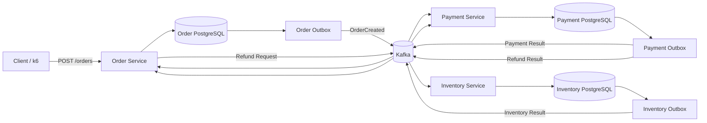
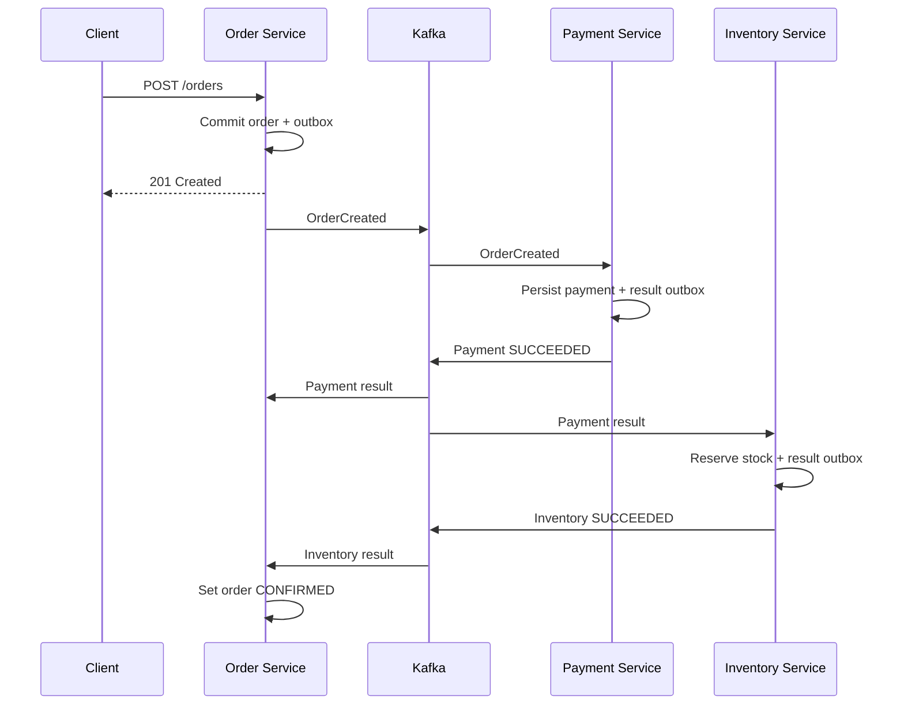
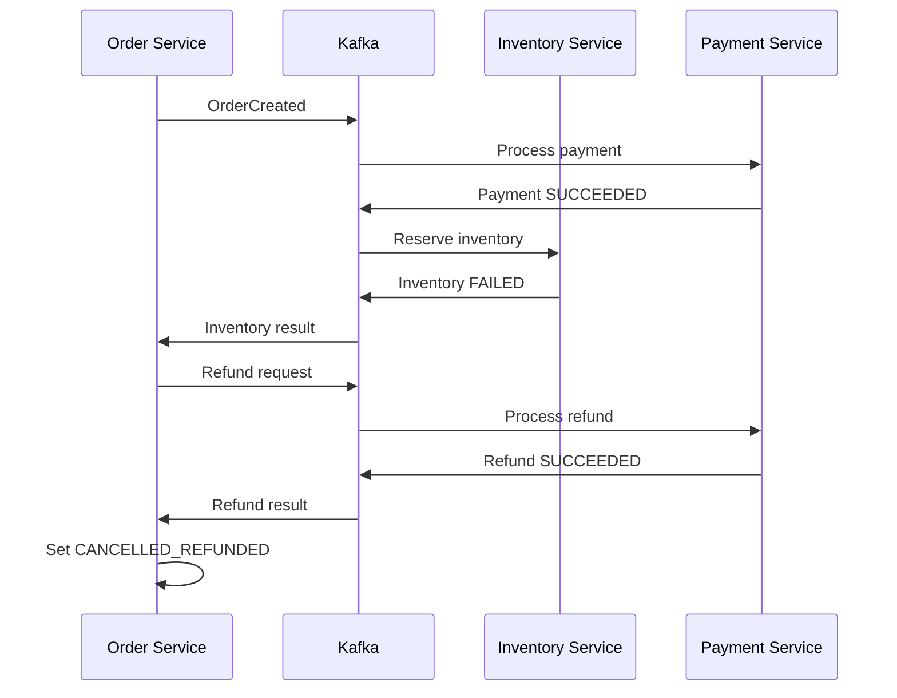

# Payment Pipeline

**An event-driven payment processing system built with Go, PostgreSQL, and Apache Kafka.**

Payment Pipeline demonstrates how distributed services coordinate a multi-step order workflow, recover from failures, and preserve reliable event delivery without a single distributed database transaction.

> **Project focus:** distributed systems, saga orchestration, transactional outbox, idempotent consumers, asynchronous messaging, and load testing.

---

## Table of Contents

- [Overview](#overview)
- [Architecture](#architecture)
- [Order Lifecycle](#order-lifecycle)
- [Reliability and Distributed Systems Concepts](#reliability-and-distributed-systems-concepts)
- [Technology Stack](#technology-stack)
- [Repository Structure](#repository-structure)
- [Getting Started](#getting-started)
- [API](#api)
- [Database and Event Flow](#database-and-event-flow)
- [Testing](#testing)
- [Load Testing and Results](#load-testing-and-results)
- [Known Limitations](#known-limitations)
- [Potential Improvements](#potential-improvements)

## Overview

A customer submits an order through the Order Service. The system processes payment asynchronously, attempts to reserve inventory, and either confirms the order or compensates for a failed reservation by refunding the payment.

Each service owns its data and communicates through Kafka events. PostgreSQL stores business state and outbox records. This design makes the workflow resilient to common failures such as a process stopping after a database commit but before publishing an event.

### Key capabilities

- **Asynchronous, event-driven workflow** using Kafka topics.
- **Saga-based compensation:** a failed inventory reservation after payment triggers a refund.
- **Transactional outbox pattern:** business-state changes and outgoing events are recorded in the same database transaction.
- **Idempotency protections** to reduce duplicate side effects when events are redelivered.
- **Explicit Kafka offset commits** after successful processing in consumers that use this approach.
- **Docker-based local environment** for running the services and infrastructure.
- **Automated tests and k6 load tests** for correctness and performance evaluation.

## Architecture



### Services

| Component | Responsibility |
|---|---|
| **Order Service** | Accepts orders, persists order state and the `OrderCreated` outbox event, and applies payment, inventory, and refund results. |
| **Payment Service** | Processes payment requests, persists payment state and payment-result events, and handles refund requests. |
| **Inventory Service** | Attempts to reserve stock, records processed events, and publishes inventory outcomes. |
| **PostgreSQL** | Stores durable service-owned business data and outbox records. |
| **Kafka** | Delivers events between services asynchronously. |
| **k6** | Generates HTTP load and measures request performance and saga outcomes. |

### Kafka topics

| Topic | Purpose |
|---|---|
| `orders` | New order events |
| `payment-results` | Payment outcomes |
| `inventory-results` | Inventory reservation outcomes |
| `refund-requests` | Requests to compensate a successful payment |
| `refund-results` | Refund outcomes |

## Order Lifecycle

### Successful fulfillment



### Compensation when inventory is unavailable



### Order states

The main success path is:

`PENDING` → `PAYMENT_SUCCEEDED` → `CONFIRMED`

The inventory compensation path is:

`PENDING` → `PAYMENT_SUCCEEDED` → `INVENTORY_FAILED` → `CANCELLED_REFUNDED`

Additional failure states can include `PAYMENT_FAILED` and `REFUND_FAILED`. A refund failure requires attention; it must not be represented as a successfully compensated order.

## Reliability and Distributed Systems Concepts

### Transactional outbox

A service writes its business change and outgoing event to the same PostgreSQL transaction. A separate publisher reads unpublished outbox rows, publishes them to Kafka, and marks them as published.

This avoids the dual-write failure in which the database commit succeeds but event publication does not—or vice versa. A crash after publication but before marking an event published can still cause redelivery, so consumers must be idempotent.

### Idempotent processing

Kafka delivery and publisher retries can result in duplicate events. Database uniqueness constraints and processed-event records help prevent duplicate business effects. Idempotency must be applied consistently across every consumer and side effect.

### Saga compensation

The workflow spans independent services and databases, so it cannot rely on one atomic transaction across the whole system. If inventory reservation fails after payment succeeds, the system requests a refund to compensate for the completed payment step.

Compensation is a new business action, not a rollback of a previously committed database transaction.

### Explicit offset commits

Where consumers use explicit Kafka offset commits, the message is committed only after processing succeeds. This supports retry after a processing failure, but it does not alone guarantee exactly-once business effects; database transactions and idempotency remain important.

### Eventual consistency

Order state changes asynchronously as events travel through Kafka and consumers process them. An order may remain `PENDING` or an intermediate state briefly after the HTTP request returns. Monitoring should distinguish temporary processing delay from a stuck workflow.

## Technology Stack

- **Go** — service implementation and concurrent background workers
- **PostgreSQL** — durable state, transactions, constraints, and outbox tables
- **Apache Kafka** — asynchronous event transport
- **Docker Compose** — local infrastructure and service orchestration
- **k6** — load generation and HTTP/saga performance metrics

## Repository Structure

The project is organized around independently runnable services. The expected top-level layout is:

```text
payment-pipeline/
├── services/
│   ├── order-service/
│   ├── payment-service/
│   └── inventory-service/
├── tests/
│   └── load/
│       ├── orders.js
│       └── saga.js
├── docker-compose.yml
└── README.md
```

Migration and configuration files live within the relevant service directories. Exact filenames may evolve as the project develops.

## Getting Started

### Prerequisites

- Go (matching the versions declared in the service `go.mod` files)
- Docker and Docker Compose
- k6, if running the load tests

### 1. Start the infrastructure

From the repository root:

```bash
docker compose up -d
docker compose ps
```

Ensure PostgreSQL and Kafka are healthy before starting the services. Apply each service's database migrations using the project's migration workflow.

### 2. Configure environment variables

Use the `.env` files or environment configuration expected by each service. For local development, the Order, Payment, and Inventory services must use the correct database and Kafka bootstrap addresses.

Do not commit real credentials. The local development credentials are for a disposable development environment only.

### 3. Start the services

Run each service using its own module and the startup instructions in its directory. The Order Service listens on port `8080`; the Payment Service health endpoint uses port `8081` in the current implementation.

Check health:

```bash
curl -i http://localhost:8080/health
curl -i http://localhost:8081/health
```

The inventory service's health route and port depend on its current implementation.

### 4. Create an order

```bash
curl -i -X POST http://localhost:8080/orders \
  -H 'Content-Type: application/json' \
  -d '{"amount_cents":2500}'
```

A successful request returns `201 Created` and a JSON object containing the order ID, amount, and initial status.

### 5. Retrieve an order's status

Replace `<ORDER_ID>` with the ID returned by the create request:

```bash
curl -i http://localhost:8080/orders/<ORDER_ID>
```

The endpoint returns the order's current state. Since processing is asynchronous, query it again to observe subsequent transitions.

## API

### `POST /orders`

Creates an order and writes an `OrderCreated` event to the outbox in the same database transaction.

**Request**

```json
{
  "amount_cents": 2500
}
```

**Example response — `201 Created`**

```json
{
  "id": "REPLACE_WITH_RETURNED_ORDER_UUID",
  "amount_cents": 2500,
  "status": "PENDING"
}
```

`amount_cents` must be positive. The ID above is a placeholder; use the actual ID returned by the service.

### `GET /orders/{id}`

Returns the current state of an order.

- `200 OK` — order found
- `400 Bad Request` — malformed order ID
- `404 Not Found` — order does not exist

### `GET /health`

Checks the Order Service and its database connection.

## Database and Event Flow

The services use separate tables for business state and outbox data. Representative data includes:

- Orders and order outbox events
- Payments and payment outbox events
- Refunds and refund outbox events
- Inventory stock, processed event identifiers, and inventory outbox events

The exact schema is defined by the migrations in each service. Database uniqueness constraints are an important part of the idempotency strategy.

## Testing

Run unit tests from each service module:

```bash
cd services/order-service && go test ./...
cd ../payment-service && go test ./...
cd ../inventory-service && go test ./...
```

Integration tests may require PostgreSQL and the correct `DATABASE_URL`. For tests that load configuration from environment variables, export them before running the test process; loading `.env` in a service's `main` function does not automatically load it in a separate test process.

Example:

```bash
set -a
source .env
set +a
go test ./...
```

Run each command from the directory containing the corresponding `.env` and `go.mod`, adjusting the path if needed.

## Load Testing and Results

Two k6 scripts exercise different layers of the system.

### HTTP order-creation test

Run from the repository root:

```bash
k6 run tests/load/orders.js
```

A previously recorded run used **50 virtual users for one minute** and reported:

| Metric | Recorded result |
|---|---:|
| HTTP requests | 29,182 |
| Request rate | ~485.5 requests/sec |
| HTTP request failures | 0.00% |
| Checks passed | 100% |
| Mean HTTP request duration | 2.63 ms |
| p95 HTTP request duration | 7.62 ms |
| Maximum HTTP request duration | 96.48 ms |

**Interpretation:** this is an HTTP order-creation result. It does not demonstrate that payment, inventory reservation, and compensation all completed at the same rate. It should not be presented as end-to-end saga throughput.

### End-to-end saga test

Run:

```bash
k6 run tests/load/saga.js
```

The saga test creates an order and polls its status until it reaches a terminal state or the polling timeout expires. Its metrics should distinguish:

- **Terminal completion rate:** percentage of orders reaching a defined terminal state
- **Fulfillment rate:** percentage reaching `CONFIRMED`
- **Compensation rate:** percentage reaching `CANCELLED_REFUNDED`
- **End-to-end latency:** time from order creation to terminal status
- **Timeouts and failures:** orders that do not finish within the allowed window or end in failure

A previous initial run at 10 VUs created 20 orders, but all 20 timed out during the test's 30-second polling window. This run did **not** establish end-to-end performance. Old `PENDING` records were also present in the database, so they should not be attributed to that run without correlating order IDs or timestamps.

Before publishing end-to-end figures, verify that the test correctly counts both successful fulfillment and successful compensation as terminal completion, seed inventory for the fulfillment scenario, and run the test against a known clean or traceable set of orders.

### Benchmarking methodology

1. Start with a low concurrency level and verify the full workflow.
2. Use known inventory to test `CONFIRMED` and insufficient inventory to test refund compensation.
3. Record run-specific order IDs or timestamps so old records do not contaminate the analysis.
4. Increase concurrency gradually (for example, 10, 25, 50, then 100 VUs).
5. Record terminal completion rate, fulfillment and compensation rates, end-to-end p95 latency, request errors, and backlog growth.
6. Report only results reproduced by the test. A target concurrency is not a measured capacity result.

## Known Limitations

- Payment processing is simulated rather than integrated with a real payment provider.
- Inventory reservation currently uses a simple product/quantity flow; it is not a complete catalog or warehouse system.
- The recorded HTTP benchmark covers order creation only.
- End-to-end performance has not yet been established: the initial saga load test timed out for every observed iteration.
- Local-development credentials and single-host infrastructure are not suitable for production.
- Kafka and PostgreSQL need operational monitoring, retention policies, recovery procedures, and deployment-level configuration for production use.

## Potential Improvements

- Add metrics and structured logs with a correlation ID across the complete saga.
- Track consumer lag, outbox age, retry counts, and terminal-state latency.
- Add controlled retries, dead-letter handling, and operational replay procedures where appropriate.
- Exercise crash/restart scenarios at transaction and publication boundaries.
- Test multiple products, quantities, and concurrent stock reservations.
- Add CI checks for unit, integration, and end-to-end tests.
- Benchmark the complete saga under reproducible load and document the hardware and configuration used.

---

## Interview Summary

**What does this project demonstrate?**

It demonstrates how to coordinate a business workflow across independently deployed services without a distributed database transaction. Each service owns its database, publishes events through a transactional outbox, and consumes events asynchronously. If inventory reservation fails after payment succeeds, the system uses a compensating refund action. Idempotency and explicit offset commits help handle redelivery and processing failures.

**Why use a saga instead of one transaction?**

A database transaction cannot atomically cover independent service databases and Kafka as one local transaction. The saga models the workflow as local transactions with explicit compensating actions, accepting eventual consistency in exchange for service autonomy.

**What performance claim is currently supported?**

A recorded k6 run measured approximately **485 order-creation requests/sec with 7.62 ms p95 HTTP latency**. This is limited to the HTTP order-creation path. End-to-end saga capacity remains unverified and should be reported only after a successful, repeatable saga benchmark.
